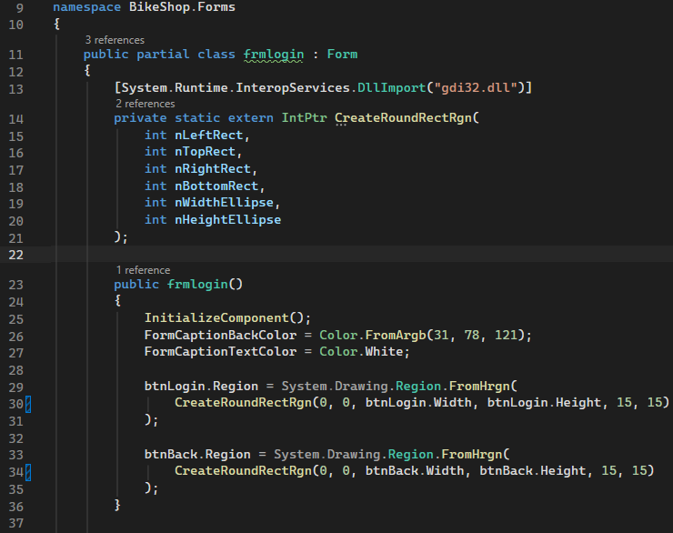

- To test only your specific form add this line to the Program.cs file
```csharp
Application.Run(new frmlogin());
```
- Font should be calibri
- The red color for buttons is 192,0,0
- The green color for buttons is 46, 125, 60

- Your forms classes should have these lines of code in your forms classes.

- lines 14-21 and 29-35 gives the buttons the rounded egdes.
- 26-27 changes the windows border to the dark blue color we had in our power point.

