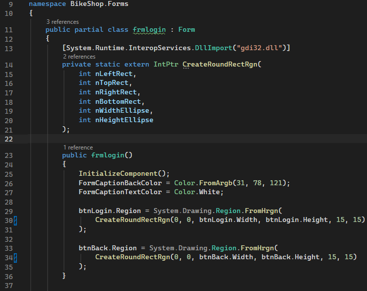

- Form size is the default 816, 489. Auto size is false. and format border style is fixed single. We can change these later if need be.
- To test only your specific form add this line to the Program.cs file and comment out the original one.
```csharp
Application.Run(new formNameHere());
```
- Font should be calibri
- The red color for buttons is 192,0,0
- The green color for buttons is 46, 125, 60

- Your forms classes should have these lines of code.

- lines 15-21 and 29-35 gives the buttons the rounded edges. Use your buttons' names where necessary.
- 26-27 changes the windows border to the dark blue color we had in our power point.
